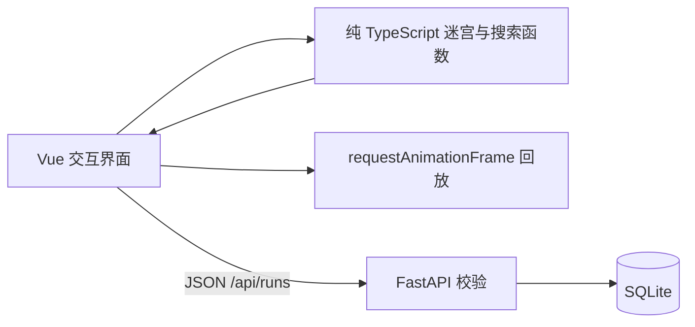

# 系统架构

PaperMaze 采用 Vue 3 + TypeScript 单页前端、FastAPI 接口和 SQLite 本地持久化。前端负责迷宫领域逻辑与动画，后端只校验和保存不可变的运行快照。这使算法演示不受网络延迟影响，也让历史记录可跨页面刷新恢复。

## 前端

- `src/core/maze.ts`：确定性 DFS 迷宫生成、移动规则、编辑规则、挑战码。
- `src/core/search.ts`：BFS、A*、路径验证。函数不修改输入迷宫。
- `src/usePlayback.ts`：按访问阶段和路径阶段回放，可暂停、变速和取消。
- `src/App.vue`：将手动探索、算法实验、编辑和历史恢复组成单页工作台。
- `src/PaperLayers.vue`：把墙体矩阵合为纸面剪影，以五层 SVG 纸面、统一投影、切口边框和轻微纸纹呈现纸雕盒。滤镜用于整层，不为每格建立滤镜。保留 SVG 屏幕矩阵反算编辑坐标。

每次生成或编辑迷宫都会取消正在运行的动画并清除旧结果，从而避免不同迷宫的结果混用。挑战码只描述生成器版本、尺寸和种子；编辑后的快照通过运行历史完整保存。

视觉参考 [pissang/papercut-box-art](https://github.com/pissang/papercut-box-art) 的叠纸、层间阴影与色阶设计；本项目使用独立编写的 SVG 实现，没有引入其 ClayGL 渲染器或复制图片资产。界面以地图为中心，设置和历史按需展开，操作说明收进原生 details，结果在运行后显示。

## 后端与数据

`POST /api/runs` 保存运行；相同 ID 与相同内容重复提交返回原记录，不同内容返回 409。`GET /api/runs` 支持模式筛选，详情接口恢复完整迷宫快照，`DELETE` 删除指定记录。Pydantic 校验矩阵尺寸、起终点、路径相邻性和模式对应指标。

SQLite 表保留索引字段和完整 JSON 载荷。当前课程项目规模无需引入 ORM 或迁移框架；`schemaVersion` 与 `generatorVersion` 为后续兼容预留明确边界。
