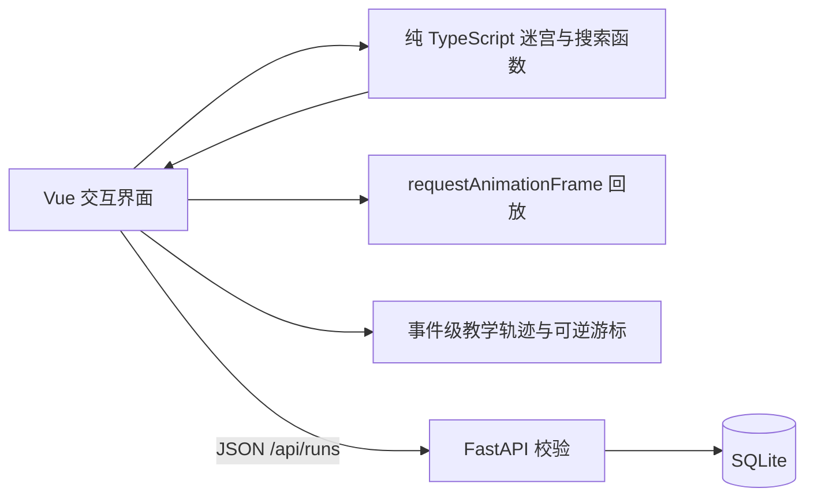

# 系统架构

PaperMaze 采用 Vue 3 + TypeScript 单页前端、FastAPI 接口和 SQLite 本地持久化。前端负责迷宫领域逻辑与动画，后端只校验和保存不可变的运行快照。这使算法演示不受网络延迟影响，也让历史记录可跨页面刷新恢复。

## 前端

- `src/core/maze.ts`：确定性 DFS 迷宫生成、移动规则、编辑规则、挑战码；`Maze.generatorId` 保留 DFS/Prim/Kruskal 身份。
- `src/core/generator.ts`：逻辑单元层的 DFS 回溯、随机 Prim、Kruskal 并查集生成器；输出冻结迷宫快照、真实结构指标和算法专属事件。
- `src/core/search.ts`：BFS、A*、路径验证，以及 BFS/A* 事件级教学轨迹和状态重放函数。函数不修改输入迷宫。
- `src/usePlayback.ts`：按访问阶段和路径阶段回放，可暂停、变速和取消。
- `src/useTeachingPlayback.ts`：过程事件的可逆游标，支持单步前进、后退、自动播放、暂停和重置。
- `src/App.vue`：将手动探索、算法实验、教学模式、生成器实验台、编辑和历史恢复组成单页工作台。
- `src/MazeBoard.vue`：统一显示迷宫、热力图、手动路线、两种搜索和教学过程；生成回放按真实的已打通边构建显示矩阵，领域快照保持不变。活动搜索只显示当前回放进度，另一种算法保留完整对比层。
- `src/PaperLayers.vue`：把墙体合为 SVG 纸面剪影，用两层切口阴影、靛蓝斜线蚀刻和纸纹呈现地图。滤镜用于整层。地图点击仍通过 SVG 屏幕矩阵反算坐标。
- `src/scenes.ts`：三幕场景的插画、叙事和生成策略。完成章节的标记保存在浏览器 localStorage；完整运行快照继续由 SQLite 保存。切换章节会清空前一张地图的运行状态。

普通搜索结果、搜索教学轨迹和生成器过程轨迹分开：`computeMs` 只包围纯搜索计算；教学/生成动画由独立播放器消费，单步、后退、变速和网络保存不会改变算法指标。生成器轨迹携带逻辑单元快照、候选边和并查集事件，回退时重放游标而不是修改迷宫矩阵。

每次生成或编辑迷宫都会取消正在运行的动画并清除旧结果，从而避免不同迷宫的结果混用。旧版挑战码只描述 DFS 版本、尺寸和种子；Prim/Kruskal 挑战码额外编码生成器身份，编辑后的快照通过运行历史完整保存。

地图延续纸层切口的 SVG 实现，当前界面采用欧洲地图册与地中海铜版画的视觉语言。场景插画是独立的 WebP 资产，背景不持续移动。入场通过 IntersectionObserver 触发一次；切景采用淡出、更新场景、淡入，减少动态效果设置下直接显示最终状态。设置、生成工坊和足迹使用原生 dialog 管理焦点、Escape 关闭及模态交互。

## 后端与数据

`POST /api/runs` 保存运行；相同 ID 与相同内容重复提交返回原记录，不同内容返回 409。`GET /api/runs` 支持模式筛选，详情接口恢复完整迷宫快照，`DELETE` 删除指定记录。Pydantic 校验矩阵尺寸、起终点、路径相邻性和模式对应指标。

SQLite 表保留索引字段和完整 JSON 载荷。当前课程项目规模无需引入 ORM 或迁移框架；`schemaVersion` 与 `generatorVersion` 为后续兼容预留明确边界。
