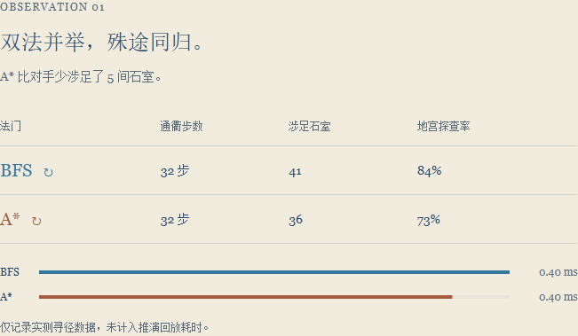

# PaperMaze 开发设计文档

学号：2311500    姓名：李锦程    选题：迷宫生成与寻路可视化

## 一、项目概述

PaperMaze 是“迷宫生成与寻路可视化”课程实践项目。系统在浏览器中生成迷宫，允许用户手动探索和编辑地图，并使用 BFS、A* 展示搜索过程和路径。运行结果连同完整地图快照保存在本地，刷新后可从历史记录恢复。

项目面向本机单用户演示，采用 Vue 3、TypeScript 和 SVG 实现交互界面，使用 Python FastAPI 提供接口，使用 SQLite 保存数据。运行时 AI 解读是可选功能；无密钥时主流程仍可运行。

图 1 中，左侧用于选择手动探索、算法寻路和步进推演；右侧地图用不同颜色展示 BFS 与 A* 的访问位置和路径。图中采用 11×11 地图和固定种子 123，便于重复演示。

## 二、需求与功能

选题第 18 题要求随机生成与重新生成迷宫、设置起点和终点、通过键盘或按钮移动、判断墙体和边界、使用至少一种寻路算法并可视化路径。系统还需显示路径长度、访问节点数或耗时，并处理无解等异常。课程统一要求强调正常启动、关键规则真实生效、数据保存闭环和基本异常处理。

- 迷宫生成：支持 11、21、31、41、51 五种方形尺寸，支持种子复现，以及 DFS、随机 Prim、Kruskal 生成过程展示。
- 手动探索：支持方向键、WASD 和屏幕方向按钮。碰墙或越界时位置不变；抵达终点后记录路线、耗时和碰撞次数。
- 编辑地图：支持设置起点、终点、墙体和通路。外围边界受保护，起终点不能重合，也不能放在墙上。
- 算法寻路：BFS 和 A* 分别计算搜索轨迹与路径；界面支持暂停、播放、变速及同图比较，并展示路径长度、访问节点数和计算耗时。
- 历史记录：保存手动完成记录和搜索结果，支持列表、筛选、恢复及删除。编辑地图后产生的记录保存完整矩阵，而不仅保存种子。
- 教学与分析：提供搜索过程单步、回退，终点距离热力图，以及迷宫通路率、死胡同数等结构指标。

## 三、设计思路与系统结构

设计的主线是“生成或编辑迷宫，亲自探索或运行算法，观察结果，然后保存与恢复”。先保证这一闭环可以在课堂上现场操作，再增加算法比较、逐步推演、结构分析和场景叙事。这样既能展示数据结构与算法，也不会让可选功能阻断验收主流程。

### 3.1 主要设计取舍

- 算法与播放分离：先完成一次搜索，再播放保存的访问顺序和路径。这样暂停、倍速和网络请求不会改变寻路结果，也不会污染算法耗时。
- 快照优先：每次运行保留完整地图、起终点和编辑状态。种子只适合重建原始生成地图，不能单独恢复手动增加或移除的墙体。
- 同图比较：BFS 与 A* 使用同一张地图，各自分配搜索状态。路径长度、访问节点和耗时由真实运行结果计算，而不是预设演示数据。
- 小规模可解释实现：使用 Vue 和 SVG 直接绘制网格与轨迹，前端负责迷宫逻辑，后端只承担校验和本地持久化；课程规模下不引入额外服务或复杂部署框架。
- AI 为辅助层：由后端读取密钥并提交有限的实验摘要，失败时使用本地规则。地图生成、移动和寻路不依赖外部 AI 服务。

[[系统架构图]]

### 3.2 模块职责

前端分为迷宫领域逻辑、搜索逻辑、过程回放和 SVG 渲染。`frontend/src/core/maze.ts` 定义地图、生成和移动编辑规则；`generator.ts` 实现生成器过程；`search.ts` 负责寻路和路径校验；`analysis.ts` 计算结构和距离场。`usePlayback.ts` 与 `useTeachingPlayback.ts` 分别控制结果播放和事件级推演，`MazeBoard.vue` 和 `PaperLayers.vue` 渲染地图，`App.vue` 负责组织用户交互。

后端由 `backend/main.py` 定义 HTTP 接口与输入校验，`backend/storage.py` 负责 SQLite 的增删查。前端提交运行数据，后端验证并写入数据库；获取历史详情时返回完整快照。前端已构建时，FastAPI 同时提供静态页面。

## 四、迷宫、移动与搜索设计

迷宫使用二维矩阵表示，0 为通路，1 为墙体；快照包含尺寸、种子、生成器标识、起终点、编辑状态和完整矩阵。搜索读取同一张地图快照，各次搜索使用独立队列、父指针和访问集合，不修改输入地图。

手动移动按上下左右计算目标格。目标格超出矩阵或为墙体时，保留原位置并记录对应碰撞；合法移动才追加到手动路径。地图编辑会清除旧搜索结果和播放状态，避免把上一张地图的结果叠加到新地图。

图 2 展示测试中手动路线到达终点后的结算窗口。测试脚本沿合法路线自动按键，因此图中的耗时是测试操作耗时，不代表人工成绩。

DFS 生成器从起点出发，随机选择未访问的逻辑单元并打通中间墙体，无候选单元时回溯。随机 Prim 和 Kruskal 生成器分别通过候选边和并查集构建迷宫。相同生成算法、尺寸和种子可以复现初始地图；挑战码不包含后续编辑，恢复编辑地图应使用运行历史。

图 3 为真实生成过程中的一个游标状态。浅色区域表示当前已打通的通路，虚线表示过程中的候选边；右下方滑条控制过程播放速度。

BFS 按队列顺序访问通路，在等权网格中找到最短步数路径。A* 使用 g + h 排序候选点，其中 g 为已走步数，h 为到终点的曼哈顿距离。两者通过父指针重建路径；找到路径后校验首尾、通路属性和相邻性，无解时返回空路径。

本次验收发现，普通 A* 在手工编辑形成环路时，曾因不更新已发现节点的更短代价而返回较长路径。修复后，若候选节点找到更小的 g 值，系统更新该节点和父指针，再按新的 f 值排序。固定反例中，修复前 BFS 为 16 步、A* 为 18 步；修复后两者均为 16 步。

## 五、指标与播放

路径长度为路径点数减一；搜索访问节点数来自实际出队的搜索轨迹。算法耗时在搜索函数内部计时，不包含页面播放、暂停、网络请求或保存时间。手动步数来自真实合法移动，碰撞不会增加步数。

比较时，系统先固定迷宫快照，再分别运行两种算法。四方向单位代价的可达地图上，路径步数可以用来检查最短路径是否一致；访问节点数反映本次搜索的实际范围。单次耗时会受到浏览器和设备状态影响，适合展示本次运行，不代表稳定的性能排名。

手动记录也使用同一套地图坐标。每次合法移动追加一个路径点，撞墙和越界则增加碰撞次数；只有到达终点后才生成完成记录。这样可以将实际探索路线与算法得到的最短步数进行对照。

图 4 是固定示例的一次实际结果：两种算法均得到 32 步路径，BFS 访问 41 个节点，A* 访问 36 个节点。时间和访问数量随地图、设备及运行状态变化，不应推广为固定性能结论。

若存在可达最短路径，手动绕路率为 `(手动步数 - 最短步数) / 最短步数`；路线效率为 `最短步数 / 手动步数`。没有可用最短路径或没有完成手动挑战时，相关指标不作有效成绩展示。

搜索先计算结果，再由独立播放器逐步显示访问点和路径。教学模式保存事件轨迹并通过游标前进和回退，播放帧数不会被当作访问节点数。

图 5 展示一次 A* 教学推演。候选序列显示节点坐标及 g、h、f；用户可以下一步或倒回一步，观察队列和父指针如何变化。教学轨迹与普通搜索结果分别生成和管理，教学事件仅保留在当前会话；动画状态不替代真实算法计算。

## 六、持久化与异常处理

SQLite 的 `runs` 表保存运行 ID、模式、创建时间与完整 JSON 载荷。载荷包括地图快照、是否找到路径、路径、访问顺序及对应指标。数据库默认位于项目根目录的 `papermaze.sqlite3`。

图 6 为独立测试数据库中的历史列表：包含一次无解搜索、一次手动完成及两次算法运行。点击“重访”会读取该条记录的完整快照；本次浏览器测试比较了恢复前后的地图矩阵和起终点。

`POST /api/runs` 保存记录；相同 ID 和内容的重复提交返回已有记录，相同 ID 但内容不同返回 409。`GET /api/runs` 查询摘要，`GET /api/runs/{id}` 返回详情，`DELETE /api/runs/{id}` 删除记录。后端校验尺寸、矩阵、起终点、路径相邻性和访问轨迹；非法数据返回 422，不存在的记录返回 404。

生成尺寸与种子有范围限制；编辑操作拒绝非法起终点和边界修改；无法到达终点时显示无解并保存空路径。服务暂不可用时，前端保留待保存记录并提供重试入口。

## 七、AI 辅助开发与运行时功能

开发过程使用 Codex 辅助需求分析、方案设计、代码编写、测试和界面重构，具体真实提示与回复节选见《AI辅助对话记录》。开发人员需要理解并验证生成内容，AI 输出不替代算法运行和测试结果。

运行时可选的 DeepSeek 解读由后端读取 `DEEPSEEK_API_KEY`，向服务发送经过校验的实验摘要。没有密钥、上游超时或返回异常时，服务使用本地规则生成解读；AI 文本不写入运行历史，也不改变算法指标。真实外部 DeepSeek 服务本次未调用。

## 八、验证与验收结果

2026 年 10 月 27 日复跑前端 Vitest：6 个测试文件、25 项测试通过；后端 pytest：12 项通过，存在一条依赖弃用警告，退出时本机 pytest 临时目录清理出现权限提示；`pnpm build` 中的 TypeScript 检查和生产构建通过。提交目录的独立源码副本完成首次依赖安装和 `start.ps1` 启动，页面及历史接口均返回 200。

使用独立 SQLite 数据库和 Edge 浏览器自动操作，验证了固定种子生成、BFS/A* 的合法路径和结果展示、键盘与按钮移动、撞墙、手动完成、设置起终点、编辑为无解地图、刷新后恢复完整编辑快照及 A* 教学单步回退。固定 11×11 示例中，BFS 路径为 32 步、访问 41 个节点，A* 访问 36 个节点；这些数值仅适用于该示例。

固定地图测试覆盖合法移动、墙体和边界、最短路径、无解、路径合法性和输入不变；后端测试覆盖保存、应用重启后读取、重复提交、ID 冲突、非法路径、筛选与删除。本次另在 Edge 中运行 51×51 地图上的 A*，并检查 390px 窗口无横向溢出；没有重新执行全部历史浏览器场景。

本次修复新增一项带环地图的固定回归测试，并使用固定伪随机种子生成 100,000 张 11×11 地图，比对 BFS 与 A* 的可达性及路径长度，未发现差异。该采样提供额外验证，不能替代对所有可能地图的穷举证明。

图 7 采用 51×51 地图与种子 12345。该次 A* 返回 372 步路径，访问 500 个节点；页面和保存接口均完成响应，浏览器未报告脚本错误。

## 九、运行与交付说明

在 Windows 安装 Python 3.11 或更高版本、Node.js 20.19.x 或 22.12 及以上版本和 pnpm，在项目根目录运行 `./start.ps1`，然后访问 `http://127.0.0.1:8000`。首次安装依赖需要网络。源码、启动和操作说明见 README；演示视频以真实操作画面配字幕展示主要功能。
